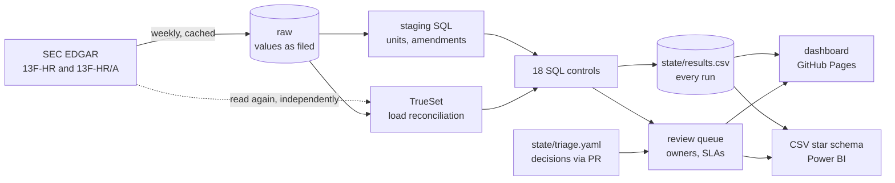

# holdings-data-quality

SQL data quality controls for investment holdings data, run every week against the real quarterly Form 13F filings that **Legal & General Group Plc** makes to the US SEC, and published as a live dashboard:

**https://tee-works.github.io/holdings-data-quality/**

Each control is a SQL query with an owner, a severity, a value-affected measure, an SLA and a triage runbook. Exceptions go into a review queue; decisions are recorded in the repository and reviewed like code; every run is kept, so the history is auditable.

> Independent project built from public filings on SEC EDGAR. Not affiliated with or endorsed by Legal & General. Exceptions are items for review under the rules described here; many will have ordinary explanations, and none is a statement that a filing is wrong. The owners, severities, SLAs and runbooks show how a firm would operate these controls on its own data; here the queue is worked by the author, and the SLA measures the author's review turnaround.



## Why 13F filings

They are among the most detailed holdings data a large asset manager publishes: the positions in US-listed securities (13(f) securities) over which the filer and the managers it includes exercise investment discretion, with CUSIP (and optionally FIGI) identifiers, share counts, market values, investment discretion and voting authority, quarter after quarter, with amendments. Small positions may be left out under the form's thresholds. That is the same shape of data an investment data quality team works with every day: positions, security reference data and prices, from several entities, reported on a deadline.

## The controls

| | Control | Dimension | Severity | Owner |
|---|---|---|---|---|
| C01 | Line count matches the summary page | completeness | critical | Regulatory Reporting |
| C02 | Line values add up to the summary page total | accuracy | critical | Regulatory Reporting |
| C03 | CUSIP is well formed with a valid check digit | validity | high | Security Master |
| C04 | FIGI, where reported, is well formed with a valid check digit | validity | medium | Security Master |
| C05 | Coded fields use the values the form allows | validity | high | Investment Data Operations |
| C06 | Other manager numbers refer to managers on the summary page | validity | medium | Regulatory Reporting |
| C07 | Voting authority split matches shares held | consistency | low | Stewardship Data |
| C08 | No line is repeated exactly | uniqueness | high | Regulatory Reporting |
| C09 | Each CUSIP has one issuer name within a filing | consistency | low | Security Master |
| C10 | Lines for one security and one entity imply the same price | accuracy | high | Pricing |
| C11 | Large quarter-on-quarter price moves, for review | accuracy | low | Pricing |
| C12 | Report scale is consistent with the previous quarter | consistency | critical | Regulatory Reporting |
| C13 | Report filed by the 45-day date | timeliness | medium | Regulatory Reporting |
| C14 | Values and quantities are present and positive | validity | medium | Investment Data Operations |
| C15 | Implied share prices are plausible | accuracy | medium | Pricing |
| C16 | Warehouse reconciles to the source document (TrueSet) | completeness | critical | Data Engineering |
| C17 | Group entities value each security at a consistent price | consistency | low | Pricing |
| C18 | A new-holdings amendment adds lines rather than repeating the report | uniqueness | high | Regulatory Reporting |

What each one checks, why it matters and how to triage it: [docs/controls.md](docs/controls.md) (generated from the SQL headers; CI fails if it is stale).

A few worth a closer look:

- **C03, C04** compute the CUSIP and FIGI check digits in plain SQL, so the check runs on any warehouse. A Python implementation exists only as the test oracle: 400 random identifiers, about half corrupted, must get the same verdict from both.
- **C10 and C17** separate two questions about prices. Lines for the same security and the same group entity should imply the same price (C10, high severity: a difference means a quantity or value does not match). Different entities in a group can legitimately price at different times or from different sources, so C17 measures how often and by how much entity prices diverge, as information for a pricing consistency review rather than as errors.
- **C11** lists price moves of more than threefold for review and clears stock splits itself. It looks for a price that fell to about 1/k of its level, for a whole k, while the share count rose by between 0.67k and 1.5k, so a 10-for-1 split is still recognised when index flows changed the position by 30% in the same quarter. Tests cover clean splits, splits with flows, consolidations and genuine jumps.
- **C12** guards the unit rule. 13F values were in thousands of dollars until 3 January 2023 and in dollars after (SEC Form 13F FAQ 62). Staging converts by filing date; C12 flags any report whose scale jumps against the previous quarter, and its detail shows the raw ratio next to the converted one, so a reviewer can see the conversion working across the change. A test proves C12 fails the 2022 to 2023 boundary when fed the values as filed.
- **C13** computes the 45-day date with weekends and US federal holidays (SEC Form 13F FAQ 25), from a holiday calendar generated in code and tested against the Presidents' Day case in February 2026.
- **C18** catches a "new holdings" amendment that is really a full report filed under the wrong type, which the staging rules would otherwise add on top of the original.

## Load reconciliation with TrueSet

Every control assumes the warehouse holds exactly what was filed, so that is tested first. Each information table is read twice: by the main parser, and by an independent reader that shares no code with it (a different XML library, XPath on local names). The warehouse is then reconciled against the independent reading with [TrueSet](https://github.com/trueset-dev/trueset), the open-source data quality library I wrote for this kind of cross-system check, by count and then line by line on identifiers, values and codes ([`contracts/load_reconciliation.yml`](contracts/load_reconciliation.yml)). TrueSet's `value_parity` reports keys missing on either side, duplicated keys and changed values in one result, which matters because a dropped line plus a duplicated one leaves the row count unchanged. A document that cannot be read is recorded rather than stopping the run. C16 reports all of this like any other control. Tests damage a copy of the warehouse (a changed value; a dropped and a duplicated line) and feed in a broken document, and check that each is caught.

## One set of controls, DuckDB and Snowflake

The controls are written once, in SQL that both DuckDB and Snowflake accept; the two places the engines name a function differently (regular expressions) go through two small Jinja macros ([`sql/macros/dialect.sql`](sql/macros/dialect.sql)). DuckDB runs the public dashboard, because it needs no account and runs inside GitHub Actions. Snowflake, the warehouse much of the industry runs on, runs the same files unchanged:

```bash
pip install -e ".[snowflake]"
export SNOWFLAKE_ACCOUNT=... SNOWFLAKE_USER=... SNOWFLAKE_PASSWORD=... SNOWFLAKE_WAREHOUSE=...
hdq snowflake        # after `hdq all`; or `hdq demo` then `hdq snowflake --sample`
```

`hdq snowflake` copies the raw tables into Snowflake exactly as loaded, creates the staging views, runs every control there, and reconciles the Snowflake results with the DuckDB results using TrueSet, per control and filing and writes the outcome to `docs/snowflake-parity.md`. Credentials stay in the environment. In CI, every rendered control is parsed as Snowflake SQL, and the whole Snowflake path runs against [fakesnow](https://github.com/tekumara/fakesnow), a Snowflake emulator, with parity required.

## From exception to closed item

1. A control run finds exceptions for a filing: an item opens (`2026Q1-C10`), with the control's owner and severity, the number of items and the value affected.
2. The review SLA runs in business days from first detection to a recorded decision: critical 1, high 3, medium 10, low 20.
3. The reviewer follows the runbook and records a decision in `state/triage.yaml` (explained, accepted, raised with source, fixed upstream) with a note, initials and date, through a pull request. The clock stops; the dashboard shows whether the SLA was met.
4. If a later run finds no exceptions (for example, after an amendment), the item resolves itself; if it comes back, it reopens. If its filing leaves the window or the control stops applying, it is withdrawn rather than left open.

The runbooks are written for someone who did not build the control, such as an offshore team working the queue overnight: what to look at first, how to tell the likely causes apart, who owns the fix and when the item can close.

## Interpretation rules (all in reviewed SQL)

- **Units.** Raw tables hold values exactly as filed. `sql/staging.sql` converts to dollars by filing date.
- **Amendments.** For each quarter, the latest of the original report and any restatement is the base, ordered by EDGAR's acceptance time; "new holdings" amendments add lines to it; anything older is superseded. Superseded reports are still checked as documents (C01, C02, C13, C16), but their lines are not counted as holdings.
- **Quarters.** Period-over-period controls compare calendar-adjacent quarters only; a missing quarter is a gap, not a reason to compare with an older one.
- **Value affected.** For line-level controls, the market value of the lines in exception: the value of holdings that cannot be relied on until the item is closed. For C02 it is the reconciliation difference; for C01, C13 and C16 it is not quantifiable and shown as n/q.

## Run it

```bash
pip install -e ".[dev]"
hdq demo                     # whole pipeline on bundled synthetic filings with planted defects; no network
open site-sample/index.html

export SEC_USER_AGENT="Your Name you@example.com"   # SEC fair access policy
hdq all                      # fetch from EDGAR, build, check, site
make serve                   # http://localhost:8000
```

`HDQ_CIK` points it at any other 13F filer. The window starts at `HDQ_SINCE` (default 2022-07-01, so it always includes the last reports filed in thousands) and grows from there.

The weekly workflow (`.github/workflows/refresh.yml`) needs two settings in the repository: a variable `SEC_USER_AGENT`, and Pages set to deploy from GitHub Actions. A filing that cannot be downloaded is reported and skipped, and one that cannot be read is recorded by C16, so one bad document never stops the dashboard from publishing.

## Outputs for Power BI

Each run writes a star schema of CSV files next to the dashboard (`site/data/`): controls, filings, every control result from every run, the latest exceptions, the review queue and a value-clear KPI per quarter. Relationships and DAX measures: [docs/powerbi.md](docs/powerbi.md).

## Tests

`pytest` (95 tests) builds a synthetic filing history in the exact SEC XML layout, with both default and prefixed namespaces, and a defect planted for each control that can fail on a single filing; it checks that every control finds its defect and nothing else. It also covers unit conversion, amendment resolution, the split rule, the holiday-aware deadline, the review lifecycle and SLA arithmetic (weekends included), the EDGAR client against a fake server (paging, idempotent downloads), the TrueSet reconciliation against deliberately damaged loads and a broken document, Snowflake rendering and DuckDB-to-Snowflake parity, the Power BI keys and the dashboard. CI also lints the Python and the control SQL.

## Limitations

- Form 13F covers 13(f) securities over which the filer exercises investment discretion; it is not the whole of any firm's assets.
- The controls see only what is in the filing. They find inconsistencies, invalid values and implausible figures; they cannot confirm a figure against the filer's books or a market price feed.
- When two lines for one security and entity disagree on price (C10), both are flagged: with two lines there is no majority to say which is wrong.
