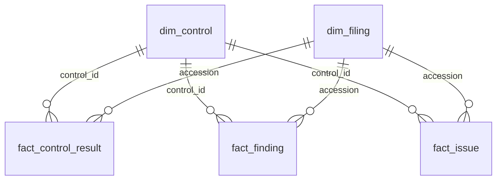

# Loading the outputs into Power BI

Every run writes six CSV files to `site/data/`, published with the dashboard, so Power BI can read them straight from the web (Get Data > Web, one URL per file) and refresh on a schedule. Locally, point it at the folder instead.

## Model



| Table | Grain | Key columns |
|---|---|---|
| `dim_control` | one row per control | `control_id`, `dimension`, `severity`, `owner`, `sla_business_days` |
| `dim_filing` | one row per filing | `accession`, `period_label`, `version_role`, `filed_date` |
| `fact_control_result` | control x filing x run (full history) | `run_id`, `status`, `population`, `exceptions`, `exception_value` |
| `fact_finding` | one exception (or auto-explained case) in the latest run | `entity`, `line_no`, `value_usd`, `detail`, `kind` |
| `fact_issue` | one issue | `issue_id`, `status`, `first_seen`, `sla_due`, `sla_state`, `triage_decision` |
| `fact_period_kpi` | one row per quarter | `value_usd`, `flagged_value_usd`, `clear_share` |

In Power Query, set `run_id` to Date/Time and `first_seen`, `sla_due`, `filed_date` and `period_of_report` to Date. Relationships are single direction, from the dimensions to the facts.

## Measures

```DAX
Latest Run = CALCULATE ( MAX ( fact_control_result[run_id] ), ALL ( fact_control_result ) )

Exceptions (latest run) =
VAR r = [Latest Run]
RETURN CALCULATE ( SUM ( fact_control_result[exceptions] ), fact_control_result[run_id] = r )

Value Affected (latest run) =
VAR r = [Latest Run]
RETURN CALCULATE ( SUM ( fact_control_result[exception_value] ), fact_control_result[run_id] = r )

Controls Failing =
VAR r = [Latest Run]
RETURN CALCULATE (
    DISTINCTCOUNT ( fact_control_result[control_id] ),
    fact_control_result[run_id] = r,
    fact_control_result[status] = "fail"
)

Value Clear % = 1 - DIVIDE ( SUM ( fact_period_kpi[flagged_value_usd] ), SUM ( fact_period_kpi[value_usd] ) )

Open Issues = CALCULATE ( COUNTROWS ( fact_issue ), fact_issue[status] = "open" )

SLA Breached = CALCULATE ( COUNTROWS ( fact_issue ), fact_issue[sla_state] = "breached" )

SLA Met % =
DIVIDE (
    CALCULATE ( COUNTROWS ( fact_issue ), fact_issue[sla_state] = "met" ),
    CALCULATE ( COUNTROWS ( fact_issue ), fact_issue[sla_state] IN { "met", "missed" } )
)
```

## Suggested pages

1. **Scorecard**: matrix of `dim_control[name]` by `dim_filing[period_label]` showing status from the latest run, with conditional formatting on status; cards for Controls Failing, Value Clear % and Open Issues.
2. **Issues**: table of `fact_issue` filtered to open and triaged, sorted by severity then SLA due date; a bar of open issues by `owner` for the weekly review.
3. **Trend**: `fact_control_result` exceptions by `run_id`, to show whether the backlog is shrinking.
